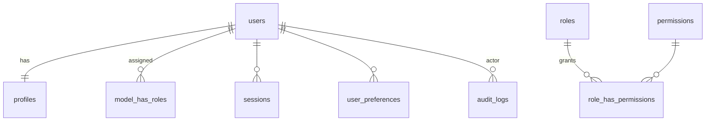
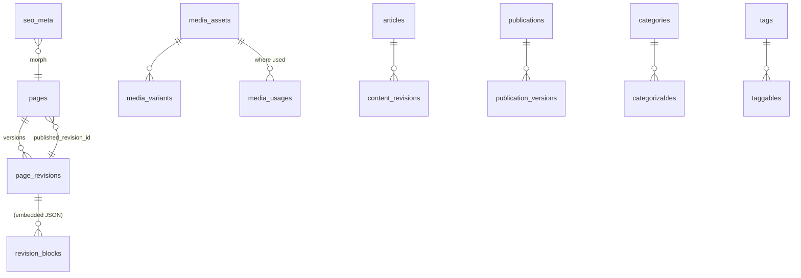
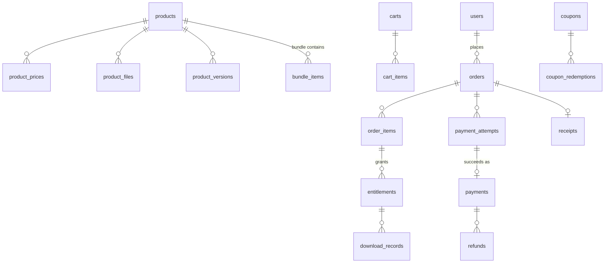
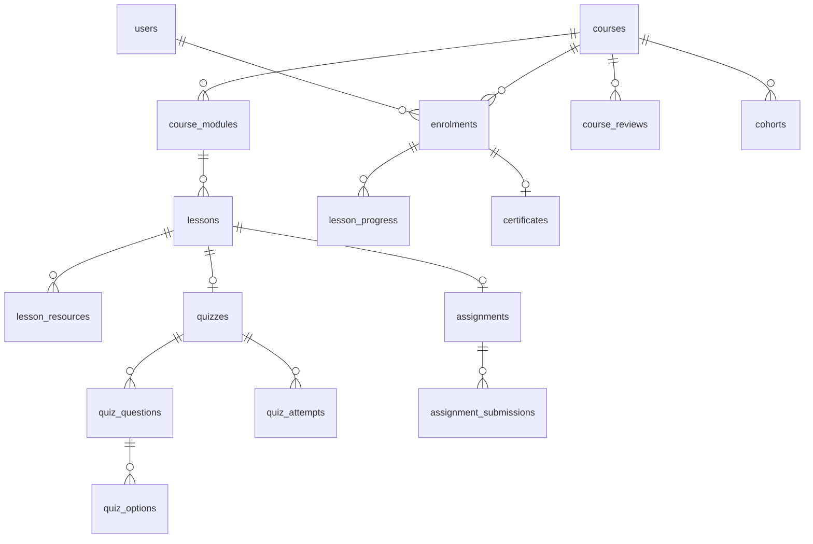

# Database Design

Status: **planned**. Laravel migrations in `apps/api/database/migrations` become the source of truth once written;
this document is kept in sync with them. Target engine MySQL 8.4 (InnoDB, `utf8mb4_unicode_ci`); local dev on
MariaDB 10.4 using the common subset (ADR-014).

## 1. Conventions

| Topic | Rule |
|---|---|
| Primary keys | `id BIGINT UNSIGNED AUTO_INCREMENT` |
| Public IDs | `ulid CHAR(26) UNIQUE` on externally referenced resources (ADR-015) |
| Timestamps | `created_at`, `updated_at` `TIMESTAMP` in UTC; domain times (`starts_at`, `paid_at`) also UTC |
| Time zones | IANA string `VARCHAR(64)` on users, events, availability rules |
| Money | `*_amount BIGINT UNSIGNED` minor units + `currency CHAR(3)`; rates `DECIMAL(18,8)` (ADR-005) |
| Coins | `BIGINT` whole coins (signed in ledger entries) |
| Enums/status | `VARCHAR(32)` backed by PHP enums (portable, migration-friendly) |
| JSON | `JSON` columns for block content, settings, metadata (MariaDB stores as validated LONGTEXT) |
| Soft deletes | Content tables (pages, articles, products, courses, posts) use `deleted_at`. **Financial tables never soft- or hard-delete.** |
| Foreign keys | Always declared. `ON DELETE RESTRICT` for financial/audit references; `CASCADE` only for pure child rows (e.g. block-in-revision, quiz options); `SET NULL` for optional authorship |
| Slugs | `UNIQUE (slug)` or `UNIQUE (scope_id, slug)`; old slugs captured in `redirects` |
| Indexes | Added for real query patterns listed per table; composite indexes lead with equality columns |

## 2. Entity overview (ERDs)

### 2.1 Identity, settings, audit

| Table | Key columns | Notes |
|---|---|---|
| `users` | email (unique), password (argon2id/bcrypt), email_verified_at, status (`active/suspended/deleted`), suspended_at, suspension_reason, two_factor_secret (encrypted), two_factor_recovery_codes (encrypted), two_factor_confirmed_at, timezone, last_login_at | index (status) |
| `profiles` | user_id (unique), display_name, handle (unique), avatar_media_id, bio, website, visibility (`public/members/private`), show_on_leaderboard (bool, default true) | |
| `roles`, `permissions`, `model_has_roles`, `model_has_permissions`, `role_has_permissions` | spatie/laravel-permission standard | |
| `sessions` | Laravel database session table (id, user_id, ip_address, user_agent, last_activity) | enables "sign out other sessions" |
| `password_reset_tokens` | email, hashed token, created_at | Laravel standard |
| `user_preferences` | user_id, key, value JSON | unique (user_id, key) |
| `settings` | group, key, value JSON, is_public | **no secrets** (secrets live in env/secret manager) |
| `audit_logs` | ulid, actor_id (nullable), action, subject_type, subject_id, changes JSON, ip, user_agent, request_id, created_at | insert-only; index (subject_type, subject_id), (actor_id, created_at) |

### 2.2 Media, CMS, publishing

| Table | Key columns | Notes |
|---|---|---|
| `media_assets` | ulid, disk (`media` public / private later), directory, filename, original_name, mime, size, width, height, title, alt_text, description, checksum_sha256 (duplicate detection), uploaded_by | **implemented M2**; index (mime), index (checksum_sha256) |
| `media_variants` | media_asset_id, variant (`sm` 320 / `md` 768 / `lg` 1280 / `xl` 1920, WebP), filename, mime, width, height, size | **implemented M2**; unique (asset, variant); cascade with asset |
| `media_usages` | media_asset_id, usable_type, usable_id, field | **implemented M2**; RESTRICT delete of in-use assets; unique per (asset, usable, field) |
| `pages` | ulid, working draft (title, slug unique, template, blocks JSON, seo JSON), is_homepage (exactly one, enforced in SetHomepage), status (`draft/scheduled/published/archived`), published_revision_id, published_at, publish_at, unpublish_at, created_by, updated_by, soft deletes | **implemented M2**; visitors only ever see the published revision |
| `page_revisions` | page_id, number (unique per page), kind (`draft/publish/restore`), title, slug, blocks JSON, seo JSON, schema_version, note, created_by, created_at | **implemented M2**; immutable; last 50 draft snapshots kept, publish/restore kept forever |
| `section_templates` | name, type, blocks JSON | reusable sections |
| `navigation_menus` | key (`header/footer/social`), items JSON | |
| `redirects` | from_path (unique), to_path, status_code, hits, is_automatic, created_by | **implemented M2**; auto-created when a published page changes address; chains collapsed, loops removed |
| `seo_meta` | seoable_type/id, title, description, canonical_url, robots, og_media_id, schema_type, extra JSON | |
| `projects` | slug, title, summary, body blocks JSON, role, tech JSON, links JSON, cover_media_id, featured, sort_order, status, published_at | portfolio/case studies |
| `skills` | name, group, level (optional), icon, sort_order | |
| `experience_entries` | title, organisation, start_date, end_date, description, sort_order, is_visible | **seeded empty** (no invented history) |
| `certifications` | name, issuer, issued_on, credential_url, media_id | seeded empty |
| `services` | slug, title, summary, body, booking_service_id (nullable), product_id (nullable), sort_order | |
| `testimonials` | author_name, author_title, quote, avatar_media_id, consent_recorded_at, is_visible | only real, consented testimonials |
| `articles` | ulid, slug, title, excerpt, body_format (`blocks/markdown`), body, cover_media_id, author_id, status, published_at, is_premium, product_id (nullable), reading_minutes | index (status, published_at); FULLTEXT(title, excerpt) |
| `content_revisions` | revisionable_type/id, number, payload JSON, created_by | for articles, projects, etc. |
| `publications` | ulid, slug, title, type (`ebook/research/paper/technical`), abstract, authors JSON, doi/isbn (optional), product_id (nullable), status, published_at | |
| `publication_versions` | publication_id, version_label, changelog, file_media_id, released_at | |
| `categories` | type (`article/product/course/community/event`), parent_id, name, slug | unique (type, slug) |
| `tags` | name, slug (unique) | |
| `categorizables`, `taggables` | polymorphic pivots | |

### 2.3 Commerce and payments

| Table | Key columns | Notes |
|---|---|---|
| `products` | ulid, type (`ebook/pdf/research/publication/template/code_package/asset/premium_article/course/event_ticket/appointment/bundle/custom`), slug (unique), title, description, status, is_free, sellable_type/sellable_id (course, ticket type, booking service), licence_terms, coin_redeemable (bool), max_coin_ratio_bp (basis points, nullable) | index (type, status) |
| `product_prices` | product_id, currency, amount, compare_at_amount, active_from, active_to | unique (product_id, currency, active_from) |
| `product_files` | product_id, product_version_id, media_asset_id (private disk), label, download_limit | |
| `product_versions` | product_id, version_label, changelog, released_at | buyers keep access to purchased version per licence |
| `bundle_items` | bundle_product_id, product_id | |
| `product_licences` | product_id, name, terms, seats | optional |
| `carts` / `cart_items` | user_id or guest token, product_id, quantity, currency | prices **not trusted** from cart — recomputed at checkout |
| `coupons` | code (unique, case-insensitive), type (`percent/fixed`), value, currency, max_uses, max_uses_per_user, starts_at, ends_at, applies_to JSON, min_subtotal | |
| `coupon_redemptions` | coupon_id, order_id (unique pair), user_id | |
| `orders` | ulid, number (unique human ref), user_id, status, currency, subtotal_amount, discount_amount, coin_discount_amount, coins_used, coin_rate_snapshot DECIMAL(18,8), total_amount, paid_at, cancelled_at, expires_at, billing_name, billing_email | **RESTRICT** deletes; index (user_id, created_at), (status) |
| `order_items` | order_id, product_id, product_snapshot JSON (title, type, version), unit_amount, quantity, discount_amount, total_amount | snapshot preserves history if product changes |
| `payment_attempts` | ulid, order_id, provider, reference (unique), amount, currency, status (`initialized/pending/succeeded/failed/abandoned`), authorization_url, provider_response JSON (sanitised), created_at | |
| `payments` | ulid, order_id, payment_attempt_id (unique), provider, provider_transaction_id (unique per provider), amount, currency, channel, paid_at, verified_at, fees_amount | unique (provider, provider_transaction_id) blocks double-fulfilment |
| `refunds` | ulid, payment_id, amount, currency, reason, status (`requested/approved/processing/succeeded/failed/rejected`), provider_refund_id, requested_by, approved_by | |
| `entitlements` | ulid, user_id, entitleable_type/id (product, course, ticket, booking), source_order_item_id, status (`active/revoked/expired`), starts_at, ends_at, revoked_reason | **unique (user_id, entitleable_type, entitleable_id, source_order_item_id)** |
| `download_records` | entitlement_id, product_file_id, ip, user_agent, signed_url_expires_at, created_at | counted against download_limit |
| `receipts` | order_id (unique), number (unique, sequential per year), issued_at, pdf_media_id | |
| `webhook_events` | provider, event_id, event_type, signature_valid, payload JSON, received_at, processed_at, status, attempts, error | **unique (provider, event_id)** → idempotency |
| `reconciliation_runs` | provider, period, discrepancies JSON, run_at | |

### 2.4 Learning

| Table | Key columns | Notes |
|---|---|---|
| `courses` | ulid, slug, title, subtitle, description blocks JSON, level, language, cover_media_id, trailer_video_id, status, published_at, product_id, pass_requirements JSON, certificate_enabled | |
| `course_modules` | course_id, title, sort_order, drip_offset_days (nullable), available_at (nullable) | |
| `lessons` | ulid, course_module_id, title, type (`video/text/code/live/quiz/assignment`), content JSON, video_asset_id, duration_seconds, is_preview, sort_order, drip_offset_days | index (course_module_id, sort_order) |
| `video_assets` | provider, provider_asset_id, status, duration_seconds, thumbnail_url | |
| `lesson_resources` | lesson_id, media_asset_id (private), label | |
| `cohorts` | course_id, name, starts_at, ends_at, capacity | optional |
| `enrolments` | ulid, user_id, course_id, cohort_id, entitlement_id, status (`active/completed/revoked`), started_at, completed_at, progress_percent, last_lesson_id | **unique (user_id, course_id)** |
| `lesson_progress` | enrolment_id, lesson_id, status, position_seconds, completed_at | unique (enrolment_id, lesson_id) |
| `quizzes` | lesson_id, pass_mark_percent, max_attempts, time_limit_seconds, shuffle | |
| `quiz_questions` / `quiz_options` | type (`single/multi/short`), prompt, points / is_correct | correct answers never sent to client before submission |
| `quiz_attempts` | ulid, quiz_id, user_id, answers JSON, score_percent, passed, started_at, submitted_at | index (quiz_id, user_id) |
| `assignments` / `assignment_submissions` | instructions, max_score / user_id, body, media_asset_id, status, score, feedback, graded_by | |
| `certificates` | ulid, verification_code (unique, random), user_id, certifiable_type/id (course, event, challenge), issued_at, recipient_name_snapshot, revoked_at | public verify by code returns minimal data |
| `course_reviews` | course_id, user_id (unique pair), rating 1–5, body, status (moderated) | only enrolled users |

### 2.5 Events, challenges, booking

| Table | Key columns | Notes |
|---|---|---|
| `events` | ulid, slug, type, title, description blocks, timezone, starts_at, ends_at, venue_type (`virtual/physical/hybrid`), meeting_url (encrypted, released to ticket holders), capacity, waitlist_enabled, cancellation_policy, status | index (status, starts_at) |
| `event_sessions` | event_id, title, starts_at, ends_at, speaker | |
| `ticket_types` | event_id, name, product_id (nullable for free), capacity, sold_count, sales_start/end, max_per_order | capacity enforced with row lock on ticket_type |
| `event_registrations` | ulid, event_id, user_id, ticket_type_id, order_item_id, status (`confirmed/waitlisted/cancelled`), registered_at | unique (event_id, user_id, ticket_type_id) |
| `tickets` | ulid, event_registration_id, code (unique), checked_in_at, checked_in_by | |
| `event_attendance` | event_id, user_id, session_id, joined_at, minutes, source | unique (event_id, user_id, session_id) |
| `challenges` | ulid, event_id (nullable), slug, title, statement blocks, rules, eligibility JSON, category_id, starts_at, ends_at, submission_type (`text/code/file/url`), scoring JSON, status | |
| `challenge_judges` | challenge_id, user_id | unique pair |
| `challenge_submissions` | ulid, challenge_id, user_id, content, language, media_asset_id, submitted_at, status | unique (challenge_id, user_id, attempt) |
| `challenge_scores` | submission_id, judge_id, criteria JSON, total, comment | unique (submission_id, judge_id) |
| `challenge_awards` | challenge_id, user_id, rank, title, reward_policy_id | |
| `booking_services` | ulid, slug, title, duration_minutes, buffer_before/after_minutes, min_notice_minutes, max_advance_days, product_id (nullable = free), mode (`native/external/both`), location_type, cancellation_window_hours, status | |
| `availability_rules` | booking_service_id (nullable = global), weekday, start_time, end_time, timezone | |
| `availability_exceptions` | date or starts_at/ends_at, type (`blocked/extra`), reason | |
| `bookings` | ulid, booking_service_id, user_id, starts_at, ends_at, timezone, status (`pending_payment/confirmed/cancelled/rescheduled/completed/no_show`), order_item_id, meeting_url, external_provider, external_id, notes | **unique (host_slot_key)** + transactional overlap check (see §4) |
| `booking_slot_locks` | booking_id, host_id, slot_start | **unique (host_id, slot_start)** — see §4 |
| `integration_mappings` | integration, local_type/id, external_id, synced_at | unique (integration, external_id) |

### 2.6 Community and gamification

| Table | Key columns | Notes |
|---|---|---|
| `community_categories` | slug, name, visibility (`public/members`), posting_min_trust | |
| `community_groups` / `group_members` | name, visibility, course_id/event_id (nullable) / role | |
| `posts` | ulid, category_id, group_id, user_id, type (`discussion/question/announcement`), title, body (sanitised Markdown), status (`published/pending/hidden/removed`), accepted_comment_id, content_hash, linked_type/id (course, lesson, event) | index (category_id, status, created_at); index (content_hash) for duplicate checks; FULLTEXT(title, body) |
| `comments` | post_id, parent_id, user_id, body, status, content_hash | |
| `reactions` | reactable_type/id, user_id, type | unique (reactable_type, reactable_id, user_id, type) |
| `bookmarks`, `follows` | user_id + polymorphic target | unique |
| `user_blocks` | blocker_id, blocked_id | unique |
| `content_reports` | reportable_type/id, reporter_id, reason, details, status, resolved_by, resolution | unique (reportable, reporter) |
| `moderation_actions` | moderator_id, target_type/id, action (`hide/remove/restore/warn/suspend/restrict`), reason, expires_at | insert-only |
| `member_restrictions` | user_id, type (`no_post/no_comment/read_only`), until, reason | |
| `reward_accounts` | user_id (unique), balance, reserved, lifetime_earned, lifetime_redeemed, updated_at | cached projection (ADR-006) |
| `reward_ledger_entries` | ulid, reward_account_id, type (`earn/reserve/release/redeem/expire/adjust/reverse`), amount (signed), balance_after, reference_type/id, idempotency_key (unique), reward_policy_id, conversion_rate_id, reverses_entry_id, reason, created_by, created_at, expires_at | **insert-only**, no `updated_at` |
| `reward_policies` | key, activity (`course_completed/quiz_passed/...`), coins, points, max_per_day/week/month, max_total, cooldown_minutes, eligibility JSON, budget_coins, budget_used, active_from/to, status | |
| `coin_conversion_rates` | currency, coins_per_unit DECIMAL(18,8) or minor_units_per_coin, active_from, created_by | historical, never edited |
| `redemption_rules` | applies_to JSON (products/categories/types), min_coins, max_coins, max_ratio_bp, campaign_id | |
| `reward_campaigns` | name, starts_at, ends_at, budget_coins, rules JSON | |
| `engagement_point_entries` | user_id, points (signed), activity, reference_type/id, idempotency_key (unique), created_at | leaderboard source |
| `achievements` | key, name, description, icon_media_id, criteria JSON, is_secret, rarity | |
| `member_achievements` | user_id, achievement_id, awarded_at, source_type/id | unique (user_id, achievement_id) |
| `leaderboard_snapshots` | period (`weekly/monthly/all_time`), period_start, period_end, rank (1..20), user_id, public_name, avatar_url, profile_slug (nullable), points, badges JSON, generated_at | unique (period, period_start, rank) — public endpoint reads only this |

### 2.7 System

| Table | Key columns | Notes |
|---|---|---|
| `announcements` | title, message, media_id, cta_text, cta_url, starts_at, ends_at, audience JSON, frequency (`once/session/daily/always`), dismissal (`session/persistent`), priority, campaign, status | global switch is setting `announcements.enabled = false` (default) |
| `announcement_events` | announcement_id, user_id or anon_id, type (`impression/click/dismiss`), created_at | aggregated nightly |
| `notification_templates` | key, channel, subject, body (Markdown + variables), locale, is_active | |
| `notifications` | Laravel standard database notifications | |
| `notification_deliveries` | notifiable, template_key, channel, status, provider_message_id, attempts, error, sent_at | |
| `newsletter_subscribers` | email (unique), status, consent_at, consent_source, confirmed_at (double opt-in), unsubscribed_at | |
| `integration_configs` | integration (unique), enabled, mode (`sandbox/live`), public_config JSON, status, last_verified_at, last_error | secrets in env only |
| `captcha_challenges` | id (random), purpose, session_hash, difficulty, expires_at, consumed_at | or Redis with TTL; unique id; purge job |
| `job_heartbeats` | job, last_run_at, last_status | scheduler monitoring |
| `contact_messages` | name, email, subject, message, status, ip_hash | |

## 3. Key constraints protecting money and access

| Risk | Constraint |
|---|---|
| Duplicate webhook processing | `UNIQUE webhook_events(provider, event_id)` |
| Double fulfilment | `UNIQUE payments(payment_attempt_id)`, `UNIQUE payments(provider, provider_transaction_id)`, order row lock + status check |
| Repeated entitlements | `UNIQUE entitlements(user_id, entitleable_type, entitleable_id, source_order_item_id)` |
| Double enrolment | `UNIQUE enrolments(user_id, course_id)` |
| Duplicate reward | `UNIQUE reward_ledger_entries(idempotency_key)`, `UNIQUE engagement_point_entries(idempotency_key)` |
| Coin double-spend | `SELECT … FOR UPDATE` on `reward_accounts`; check `balance - reserved >= n`; reservation entry per order (`idempotency_key = reserve:{order}`) |
| Overselling tickets | lock `ticket_types` row; `sold_count < capacity` check inside transaction |
| Coupon over-use | lock coupon row; count redemptions in transaction; unique (coupon_id, order_id) |

## 4. Booking double-booking prevention

MySQL has no exclusion constraints, so:
1. Slots are discretised to the service's slot grid. Each confirmed/pending booking inserts rows in
   `booking_slot_locks(host_id, slot_start)` with `UNIQUE(host_id, slot_start)` for every grid slot it occupies
   (including buffers). A concurrent insert for an overlapping slot fails on the unique index.
2. The insert happens in the same transaction as the booking; cancellation deletes its slot-lock rows.
3. Pending-payment bookings hold slots for a short TTL (e.g. 15 min); an expiry job releases them.

## 5. Deletion and retention

| Data | Policy |
|---|---|
| Orders, payments, refunds, receipts, ledger entries, audit logs, webhook events | Retained ≥ 6 years (tax/accounting — confirm with accountant); never cascaded from user deletion |
| User account deletion | Profile anonymised (name → "Deleted member", email → hashed placeholder), community posts anonymised or removed per member choice, sessions/tokens deleted; financial rows keep `user_id` FK but PII snapshot fields are redacted where law permits |
| Content (pages, articles) | Soft delete, purge after 90 days in trash |
| Captcha challenges, password reset tokens, expired sessions | Purged daily |
| Announcement events, download records | Aggregated after 13 months; raw rows purged |
| Contact messages | 24 months |
| Backups | Daily encrypted DB dump retained 30 days; weekly retained 12 weeks (see BACKUP_AND_RECOVERY.md in Milestone 9) |

## 6. Seed data

- **All environments:** roles & permissions, default settings (announcements **disabled**), notification templates,
  block/section templates, Super Administrator created via an interactive console command (no default password).
- **Local/testing only:** draft profile content from PRODUCT_REQUIREMENTS §3, sample *draft* pages, clearly labelled
  demo products/courses (`[DEMO]`), fake users via factories. Demo seeders refuse to run when `APP_ENV=production`.
- No fake customers, orders or transactions ever seeded outside local/testing.
