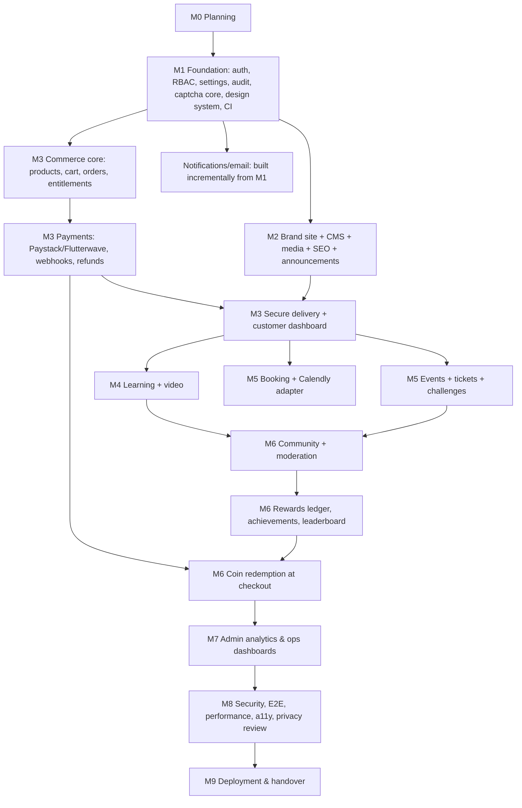

# Implementation Roadmap

Legend: `[x]` done and verified · `[~]` in progress · `[ ]` not started · `[!]` blocked (reason given).

## 1. Repository audit (2026-10-14)

| Item | Finding |
|---|---|
| Repository | `C:\xampp\htdocs\ifeanyiosiaku` was **empty**; not a Git repository. Greenfield project. |
| Existing code, migrations, auth, tests | None |
| PHP | 8.3.33 CLI (XAMPP), extensions include pdo_mysql, mbstring, intl, gd, bcmath, sodium, zip, fileinfo, curl, openssl ✔ (no `redis`, `imagick`) |
| Composer | 2.10.3 at `C:\ProgramData\ComposerSetup\bin` (not on the Bash PATH; usable by full path) |
| Node / npm | Node 24.20.0, npm 11.19.0 ✔ (Next.js 16 requires ≥ 20.9) |
| Database | XAMPP **MariaDB 10.4.32**, running, root without password locally. Many unrelated databases exist on this server — this project will only create `ifeanyiosiaku` and `ifeanyiosiaku_testing`. MariaDB 10.4 is end-of-life. |
| Redis | Not installed |
| Docker | Not installed |
| Git | 2.41 installed |
| Network | npm registry reachable; **packagist.org unreachable from the planning sandbox** (Composer installs may need to run outside the sandbox) |
| Assets | Instructor-profile artwork found at `Downloads/ifeanyi.png` (1.9 MB poster). Contains portrait + text + third-party training branding; usable as content reference, **not** as a clean hero portrait. Not yet copied into the repo. |
| Hosting | Not confirmed. Domain ownership/DNS not confirmed. |

## 2. Dependency graph

Admin (Filament) screens and tests are built **with** each module, not deferred to M7. M7 adds cross-module
reporting, KPIs and operational health.

## 3. Milestones and checklists

### Milestone 0 — Discovery and planning
- [x] Inspect repository and local environment
- [x] Review supplied profile artwork
- [x] PRODUCT_REQUIREMENTS.md
- [x] SYSTEM_ARCHITECTURE.md
- [x] DATABASE_DESIGN.md (with ERDs)
- [x] SECURITY_THREAT_MODEL.md
- [x] IMPLEMENTATION_ROADMAP.md (this file: dependency graph, checklists, risks, definition of done)
- [x] INTEGRATION_REGISTER.md
- [x] DEPLOYMENT_PLAN.md
- [x] DECISIONS.md
- [x] Owner decision (2026-10-14): accept all defaults in PRODUCT_REQUIREMENTS §7 (Filament admin, VPS hosting target, "Ifeanyi Osiaku", placeholder portrait in development). Hosting provider and portrait still to be supplied.

**Acceptance:** documents exist, are mutually consistent, and are reviewed by the owner.

### Milestone 1 — Foundation
Status as of 2026-10-15: **complete except two items deferred to later milestones** (email-template editor → M7, Playwright → M8).

1. [x] Git repository initialised (`main`), `.gitignore`, `.editorconfig`, `.gitattributes`, deny-all `.htaccess`, README, `.env.example` files; first commit pushed to GitHub (owner approved 2026-10-14)
2. [x] Laravel 13.36 in `apps/api`; MySQL connection; `ifeanyiosiaku` + `ifeanyiosiaku_testing` databases
3. [x] Next.js 16.4 in `apps/web` (TypeScript strict, Tailwind 4, ESLint, Prettier)
4. [x] Next.js rewrites to Laravel (API, admin, admin assets); CORS restricted to configured origins; trusted proxies — *Sanctum removed, see ADR-003 amendment*
5. [x] JSON error envelope, request-ID middleware (Laravel Context → logs/jobs), security headers (API + website)
6. [x] Settings module (defaults + DB overrides, public whitelist, audited changes); append-only audit log
7. [x] Registration, email verification, login/logout, password reset (Fortify, headless JSON)
8. [x] Session list + revoke one / revoke others; suspension (kills sessions, blocks login, ends open sessions); staff access revoked when roles removed
9. [x] TOTP 2FA with recovery codes; required for staff before `/admin`
10. [x] Roles/permissions from enums (idempotent seeder), policies, guarded Super Admin (no self-demotion of last owner), `app:create-super-admin`
11. [x] CAPTCHA abstraction: first-party proof-of-work (default), reCAPTCHA, Turnstile; on registration, password reset, and login after 3 failures
12. [~] Queued verification and reset emails with retries; delivery log (`notification_deliveries`). **Not done:** editable notification templates table — moved to Milestone 7 with the template editor
13. [x] Filament admin (dark, brand colours): Users (view, filter, suspend, reinstate, change roles), read-only Audit log, and Site settings (content protection, registration, announcement master switch, staff 2FA, CAPTCHA provider — audited)
14. [x] Design tokens; Button, TextField, Card, Alert, Spinner, Skeleton, EmptyState, ErrorState (retry + support reference), Toast (live-region announcements), Dialog, Tabs, Accordion; reduced-motion support
15. [x] Website pages: register, login, verify email, forgot/reset password, 2FA challenge, account overview, account security (2FA setup, recovery codes, sessions, password change)
16. [x] Health: `/up`, `/api/v1/health` (details for permitted staff only), website `/healthz`, scheduler heartbeat
17. [~] Pest, Larastan (level 8), Pint, Vitest, Testing Library, axe; `scripts/setup.ps1`, `dev.ps1`, `test.ps1`. **Not done:** Playwright browser tests (Milestone 8; an HTTP-level end-to-end smoke test was run instead, see results)
18. [x] GitHub Actions CI (MySQL 8.4, PHP 8.3, Node 24; style, static analysis, tests, build, audits) — **green on GitHub** since commit a435d1c (2026-10-15). The first run failed because the then-empty `tests/Unit` folder is not stored by Git; resolved. Test failures are now published as public annotations.
19. [x] docs/LOCAL_SETUP.md
20. [x] Content protection (owner request 2026-10-15, ADR-024): image saving, right-click and Inspect shortcuts blocked on the website by default; admin switch; verified in Chrome both ways
21. [x] Add-on switches for Commerce, Learning, Community, Rewards (owner request 2026-10-15, ADR-025): settings, admin toggles, `addon:` route guard, website `useAddon()`; staff 2FA requirement OFF in development / ON in production (ADR-026)

**Verified results (2026-10-14, this machine):**
- API: 111 Pest tests, 387 assertions, all passing on MariaDB 10.4; Larastan level 8: 0 errors; Pint: clean.
- Website: 23 Vitest tests passing (incl. axe accessibility checks on form components); ESLint clean; `tsc` clean; production build succeeds.
- End-to-end through the proxy (`localhost:3100` → Laravel `:8110`): 20/20 HTTP checks (health, CSRF, CAPTCHA-protected registration, sign-in/out, sessions, admin refusal/redirect, security and no-cache headers), plus staff sign-in with a real TOTP code and the admin dashboard, stylesheet and Livewire script loading through the proxy.
- Verified on GitHub CI (2026-10-15): full backend suite on MySQL 8.4 and the website build. Not verified: real email delivery (log mailer only), reCAPTCHA/Turnstile against live Google/Cloudflare (tested with HTTP fakes), visual review of pages in a browser.

**Acceptance tests:** registration → verification email (log mailer) → verify → login → logout; password reset
token single-use and expiring; throttling; suspended user cannot log in and existing sessions die; non-admin
receives 403 on admin endpoints; staff without 2FA forced to enrol; CAPTCHA matrix (valid/invalid/expired/replay/
provider failure/rate limit); CSRF rejection; health endpoints respond; CI green.

### Milestone 2 — Brand website and CMS
- [x] Media library: real-type detection, size/dimension limits, re-encoding (strips EXIF/GPS), WebP variants, required alt text, duplicate detection, usage tracking blocks deletion, `/media` serving with safe headers, admin screens, content permissions (cms.manage/publish/raw_html, media.manage). Private disk for paid files arrives with Commerce (M3).
- [x] Pages + immutable revisions + draft/preview/publish/schedule + restore (API side; admin editor with Save draft / Preview / Publish / Unpublish / Make homepage / trash; version history with restore; automatic redirects on address change; signed 15-minute preview links; scheduled publish/unpublish job)
- [x] Block registry with 19 block types: server-side validation and sanitising, Filament builder (reorder, duplicate, hide, anchors), website renderers with Zod checks, Shiki code highlighting (incl. DAX), click-to-play video, responsive images. **Remaining:** data-driven homepage sections (step 4); download and diagram blocks; raw HTML block (step 8)
- [x] Code block / terminal panel with Shiki, line numbers, highlights, copy, annotations (verified in Chrome)
- [ ] Markdown article layout; articles, categories, tags, publications + versions
- [x] Portfolio: Profile page (name, headline, bios, years, portrait), projects/case studies (/projects/{slug}), skills & technologies, services, experience (empty), certifications (empty), testimonials (consent required); 7 data-driven blocks; content refreshes the site instantly; media in use is protected
- [x] Navigation/header/footer/social config (admin screen; phone menu; add-on-aware links); accent colour presets applied as design tokens (contrast-tested) — ADR-028
- [x] Slugs + automatic and manual redirects (loop/chain protection, visit counts, https destinations); per-page SEO fields; sitemap.xml, robots.txt, search-engine indexing switch, JSON-LD (Person, WebSite, CreativeWork) — ADR-028
- [~] Homepage composed of configurable section blocks (hero with portrait + terminal, about, expertise, work, services, call to action), reduced-motion safe. **Remaining:** subtle code-particle/grid motion effects; sections from later modules (courses, products, articles, events, leaderboard) arrive with those modules
- [ ] Raw HTML block in sandboxed iframe (Super Admin only)
- [ ] Announcement popup (global OFF default), analytics events
- [ ] Contact form (CAPTCHA, rate limit, email notification); newsletter (double opt-in, feature flag)
- [x] Next.js on-demand revalidation on publish (verified end-to-end: publish visible immediately; renamed page 301; missing page 404 via proxy pre-check, ADR-027)
- [x] InitialContentSeeder: approved profile copy, portrait, 9 skills, published homepage; experience/certifications/testimonials left empty (no invented history)

**Acceptance:** Journey F; homepage sections reorder/hide/duplicate from admin; announcement suppressed by global
switch even when scheduled; Lighthouse/axe report recorded (measured, not assumed).

### Milestone 3 — Commerce
- [ ] Gate every route, page and admin screen behind the `commerce` add-on (ADR-025)
- [ ] Products, prices, files, versions, categories/tags, bundles, licences, search/filter, related
- [ ] Cart (guest + user, merge on login), checkout with server-side pricing, coupons
- [ ] Orders + state machine + audit; order expiry job
- [ ] PaymentGateway contract; Paystack adapter; Flutterwave adapter; FakeGateway (tests)
- [ ] Webhook endpoint + `webhook_events` idempotency + queued processing + verify-call
- [ ] Entitlements; fulfilment on `OrderPaid`; receipts (numbered) + email
- [ ] Secure downloads (signed URLs, limits, logs)
- [ ] Customer dashboard: orders, receipts, downloads
- [ ] Refund workflow (admin) + provider refund + entitlement revocation
- [ ] Reconciliation job/report; sales reports
- [ ] integration_configs status + "Test connection" (sandbox)

**Acceptance:** Journey A against Paystack **sandbox** (and Flutterwave sandbox) once test keys supplied; until
then, against FakeGateway and recorded webhook fixtures, reported as such. Tests: duplicate webhook, forged
signature, amount mismatch, concurrent confirmations, unentitled download denied, expired URL denied.

### Milestone 4 — Learning
- [ ] Gate behind the `learning` add-on; free courses keep working when `commerce` is off (ADR-025)
- [ ] Courses, modules, lessons, resources, previews, drip, cohorts, bundles (via commerce)
- [ ] VideoProvider contract + Bunny Stream adapter + local dev adapter; signed playback
- [ ] Enrolment on purchase or free enrol; learner dashboard; lesson player; resume; progress
- [ ] Quizzes (server-side grading), assignments (submission + grading)
- [ ] Certificates + public verification page
- [ ] Reviews (enrolled only, moderated); course analytics

**Acceptance:** Journey B; unenrolled user cannot fetch lesson content or playback token; quiz answers never
leaked before submission.

### Milestone 5 — Events, challenges, appointments
- [ ] Events, sessions, ticket types (capacity-safe), registration, waitlist, cancellation policy
- [ ] Meeting link release to ticket holders only; reminders; .ics export; check-in; attendance; certificates
- [ ] Challenges: statements, windows, submissions, judges, scoring, rankings, awards
- [ ] Booking services, availability rules/exceptions, slot generation (time zones, buffers, notice, window)
- [ ] Booking with slot-lock table (no double booking), payment hold TTL, confirm/cancel/reschedule, reminders
- [ ] SchedulingProvider contract + Calendly adapter (OAuth, webhooks, sync) — shows "not connected" until verified
- [ ] Reports: participants, event revenue, bookings

**Acceptance:** Journeys C and E; concurrency test for last ticket and same booking slot.

### Milestone 6 — Community and rewards
- [ ] Gate behind the `community` and `rewards` add-ons; coin redemption also requires `commerce` (ADR-025)
- [ ] Community categories, posts, Q&A, comments, reactions, bookmarks, follows, groups, course/event discussions, search
- [ ] Moderation: reports, queue, actions, restrictions, blocks, rate limits, duplicate checks, new-member limits
- [ ] Reward accounts + append-only ledger + policies + rule engine + idempotency
- [ ] Engagement points + achievements + leaderboard snapshots (≤ 20, weekly/monthly/all-time)
- [ ] Coin redemption at checkout (reserve/redeem/release), conversion rates, eligibility, caps, expiry job, campaigns, budgets
- [ ] Reward reports (issued/redeemed/expired/outstanding/suspicious)

**Acceptance:** Journey D; concurrent redemption test; reversed ledger entries via compensation only; leaderboard
never exceeds 20, honours privacy flag, exposes no balances.

### Milestone 7 — Administration and analytics
- [ ] KPI dashboard with metric definitions (SYSTEM_ARCHITECTURE §11)
- [ ] Reports per module with permission controls and CSV export
- [ ] Integrations page with honest status; operational health (queue lag, failed jobs, scheduler heartbeat, storage)
- [ ] Notification preferences and template editor

### Milestone 8 — Security and quality
- [ ] Full threat-model test pass (SECURITY_THREAT_MODEL §4)
- [ ] Playwright Journeys A–F green in CI
- [ ] CSP enforced; headers verified
- [ ] Performance measured (Lighthouse CI / WebPageTest), query review, caching verified for public only
- [ ] Accessibility audit (axe + manual keyboard/screen reader spot checks)
- [ ] Privacy review checklist; legal documents supplied by owner

### Milestone 9 — Deployment and handover
- [ ] Staging environment on confirmed host; production environment
- [ ] README, LOCAL_SETUP, PRODUCTION_DEPLOYMENT, BACKUP_AND_RECOVERY, ADMIN_USER_GUIDE, TESTING_GUIDE, INTEGRATION_SETUP
- [ ] Backup + **tested restore**; rollback rehearsal
- [ ] Live payment test transaction (owner-run, refunded) → mark provider production-verified
- [ ] Launch checklist signed off

## 4. Risk register

| # | Risk | Likelihood | Impact | Mitigation | Owner |
|---|---|---|---|---|---|
| R1 | Hosting plan cannot run Node server, queue workers, Redis | Medium | High | Confirm host before M1 ends; recommend VPS (ADR-018) | Owner + Eng |
| R2 | Local MariaDB 10.4 (EOL) differs from production MySQL 8.4 | High | Medium | Portable migrations; CI on MySQL 8.4; recommend local upgrade | Eng |
| R3 | Packagist blocked in the build sandbox | Medium | Medium | Run Composer outside sandbox with owner approval | Eng |
| R4 | Payment-provider credentials/business verification delayed | High | High | Build against sandbox + FakeGateway; live verification is a launch gate | Owner |
| R5 | Scope is very large for one delivery stream | High | High | Strict milestone order; revenue paths (M1–M3) first; P2 items deferred | Eng |
| R6 | Owner is non-technical; admin complexity | Medium | Medium | Filament admin, ADMIN_USER_GUIDE, sensible defaults, guard rails | Eng |
| R7 | Reward credits create financial/legal liability | Medium | High | Closed-loop, no cash value, expiry, budgets, legal review of terms | Owner |
| R8 | Spam/abuse in community and forms | High | Medium | CAPTCHA, rate limits, moderation queue, new-member limits | Eng |
| R9 | Paid content piracy | Medium | Medium | Signed URLs, entitlement checks, licence terms; documented limits | Owner |
| R10 | Animation hurts performance/accessibility | Medium | Medium | Reduced motion, transform-only, measured budgets | Eng |
| R11 | Missing clean portrait/brand assets | High | Low | Request from owner; dev placeholder only | Owner |
| R12 | Privacy/legal documents absent at launch | Medium | High | Launch gate in M8/M9 | Owner |
| R13 | Single developer bus factor / session interruptions | Medium | Medium | HANDOVER.md kept current; docs and tests in repo | Eng |
| R14 | Email deliverability (SPF/DKIM/DMARC) | Medium | Medium | Configure DNS records with provider in M9; staging tests | Owner + Eng |
| R15 | Third-party branding in supplied artwork used without permission | Low | Medium | Not hard-coded; owner adds affiliations explicitly via CMS | Owner |

## 5. Definition of done (applies to every feature)

A feature is **done** only when all of the following are true:

1. Implemented end-to-end (database → API → UI/admin) with real persistence — no hard-coded demo data in production paths.
2. Server-side validation and authorisation (policy) on every operation; deny-by-default.
3. Automated tests cover the happy path, validation failures, authorisation failures and the module's specific
   risks (concurrency, idempotency, etc.); all tests pass locally and in CI.
4. Static analysis, lint and type checks pass with no new suppressions.
5. Migrations are reversible where possible and documented in DATABASE_DESIGN.md.
6. Loading, empty, error, success and disabled UI states exist; keyboard accessible; reduced-motion safe.
7. Audit logging for staff/financial actions; no secrets or PII in logs.
8. Documentation updated (relevant docs, `.env.example`, INTEGRATION_REGISTER status).
9. Integration status reflects reality (never "connected" without a successful real call).
10. Results reported honestly, including failures, skips and remaining risks.

A **milestone** is done when all its features meet the definition of done and its acceptance tests/journeys pass.

## 6. Known issues and follow-ups (open)

| # | Issue | Impact | Plan |
|---|---|---|---|
| K1 | `npm audit` reports 5 high advisories in **dev-only** tooling (`braces` via `@next/eslint-plugin-next` → `fast-glob`) | None in production (`npm audit --omit=dev`: 0 vulnerabilities) | Update when eslint-config-next ships a fixed range; CI audits production deps only |
| K2 | `composer audit` could not be re-run at the end of the session (Packagist timed out); the last completed audit reported no advisories | Unknown until re-run | CI runs `composer audit --locked` on every push |
| K3 | PHP on this machine intermittently cannot reach GitHub/Packagist (curl error 28) | Slower dependency installs | Retry; cache pre-fill workaround in HANDOVER.md |
| K4 | Local database is MariaDB 10.4 (end-of-life) | Possible drift from MySQL 8.4 | CI tests on MySQL 8.4; upgrade local DB when convenient |
| K5 | Website Content-Security-Policy is report-only | Weaker XSS defence until enforced | Nonce-based CSP enforced in Milestone 8 |
| K6 | Homepage is an interim page with the approved draft profile copy | Not the final cinematic homepage | Rebuilt from CMS sections in Milestone 2 |
