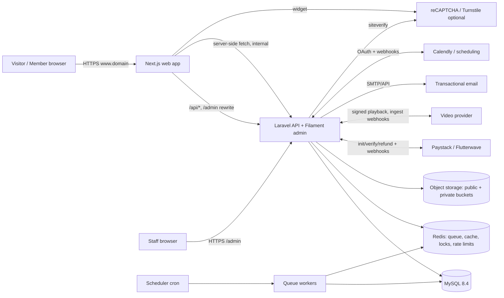

# System Architecture

Status: **planned** (Milestone 0). Decisions referenced as ADR-nnn are in [DECISIONS.md](DECISIONS.md).

## 1. Context



## 2. Repository layout

See ADR-001. Inside `apps/api`:

```
app/
  Domain/
    Identity/      users, profiles, roles, sessions, 2FA, suspension
    Settings/      typed app settings, design tokens, feature flags
    Audit/         audit log writer + model
    Media/         media assets, variants, usage references
    Cms/           pages, revisions, blocks, navigation, redirects, SEO
    Publishing/    articles, publications, versions, categories, tags
    Commerce/      products, cart, orders, coupons, entitlements, downloads, refunds
    Payments/      PaymentGateway contract, Paystack/Flutterwave adapters, webhooks, reconciliation
    Learning/      courses, modules, lessons, enrolments, progress, quizzes, assignments, certificates
    Video/         VideoProvider contract + adapters
    Events/        events, sessions, ticket types, registrations, attendance
    Challenges/    challenges, submissions, judges, scores
    Booking/       services, availability, exceptions, bookings, SchedulingProvider adapters
    Community/     categories, posts, comments, reactions, bookmarks, follows, groups, reports, moderation
    Rewards/       accounts, ledger, policies, redemption, achievements, engagement points, leaderboard
    Captcha/       CaptchaVerifier contract + first-party/reCAPTCHA/Turnstile drivers
    Notifications/ templates, preferences, delivery log
    Announcements/ announcements, targeting, analytics
    Analytics/     metric definitions, aggregations, report queries
    Integrations/  integration configs, connection status, webhook_events
  Http/
    Controllers/Api/V1/...   thin controllers
    Requests/                FormRequest validation
    Resources/               JSON resources (public shape)
    Middleware/              correlation ID, security headers, suspended-user guard
  Filament/                  admin panel resources (ADR-008)
```

Each domain module contains `Models/`, `Actions/` (single-purpose business operations), `Services/`, `Events/`,
`Listeners/`, `Policies/`, `Enums/`, `Contracts/` and `Adapters/` as needed.

Inside `apps/web`:

```
src/
  app/
    (public)/           home, about, portfolio, [slug] CMS pages, articles, store, courses, events, booking, community, leaderboard
    (account)/          dashboard, orders, downloads, learning, bookings, tickets, rewards, settings (no-store, noindex)
    learn/[course]/     lesson player
    api/preview/        draft-mode entry with signed token
    sitemap.ts, robots.ts
  components/
    ui/                 design-system primitives (Button, Card, Dialog, Tabs, Accordion, Toast, Skeleton...)
    blocks/             CMS block renderers (registry keyed by block type)
    motion/             reduced-motion-aware animation helpers, terminal/code/particle effects
  lib/
    api/                typed API client (server + browser), error mapping
    schemas/            Zod schemas (mirrors API block schemas)
    auth/               session state, safe redirects, password confirmation
  styles/tokens.css     design tokens (CSS variables)
```

## 3. Request flows

### 3.1 Public page (SSR / ISR)
1. Request `GET /about` → Next.js server component.
2. Server fetches `GET /api/v1/pages/about` (internal URL) with a revalidate tag `page:about`.
3. Renders blocks through the registry; Shiki highlights code server-side.
4. On publish, Laravel fires `PagePublished` → queued job calls Next.js `POST /api/revalidate` (shared secret) with
   the tag → cache invalidated. Scheduled publishes do the same from the scheduler.

### 3.2 Authenticated browser call
1. Browser `GET /api/v1/csrf-cookie` (proxied) → `XSRF-TOKEN` cookie.
2. `POST /api/v1/auth/login` with `X-XSRF-TOKEN` header → session cookie (HttpOnly, Secure, SameSite=Lax).
3. Subsequent `/api/v1/...` calls carry the session; policies authorise each action.
4. Authenticated pages send `Cache-Control: private, no-store` and `X-Robots-Tag: noindex`.

### 3.3 Checkout and payment

```mermaid
sequenceDiagram
  participant B as Browser
  participant API as Laravel
  participant G as Gateway (Paystack/Flutterwave)
  participant Q as Queue
  B->>API: POST /checkout (cart, coupon, coins)
  API->>API: TX: revalidate prices, coupon, coin rate & balance; create Order(pending_payment); reserve coins
  API->>G: initialize(amount, currency, reference=order.ulid+attempt)
  G-->>API: authorization_url
  API-->>B: redirect URL
  B->>G: pays on hosted page
  G-->>B: redirect to /checkout/return?ref=...
  B->>API: GET /orders/{ulid}/status (polls; redirect itself is NOT trusted)
  G->>API: webhook charge.success (signed)
  API->>API: verify signature, store webhook_event (unique), dispatch job
  Q->>G: verify(reference)  [server-to-server]
  Q->>API: TX lock order: amount+currency match? -> Payment(succeeded), Order(paid), commit coin reservation, create Entitlements (unique), queue receipt email
```

Either the webhook or the status poll can trigger verification; both funnel into the same idempotent
`ConfirmPayment` action guarded by a row lock on the order and unique constraints on payments and entitlements.

### 3.4 Order state machine

```
draft → pending_payment → paid → fulfilled
                ↘ failed (attempt can be retried → pending_payment)
                ↘ cancelled / expired (coin reservation released)
paid|fulfilled → partially_refunded → refunded   (entitlements revoked per policy; coin compensation entries)
```
Transitions are only made by domain actions; each transition is audit-logged with actor and reason.

### 3.5 Protected download
`GET /api/v1/downloads/{entitlement}/{file}` → policy (owner, entitlement active, limit not exceeded) → record
`download_records` row → respond with 302 to a signed URL valid ≤ 5 minutes (private bucket). Local dev uses Laravel
temporary signed routes on the private disk.

## 4. Domain interactions (events)

| Event | Emitted by | Consumed by |
|---|---|---|
| `OrderPaid` | Payments | Commerce (entitlements), Learning (enrolment), Events (tickets), Booking (confirm), Rewards (commit redemption), Notifications |
| `OrderRefunded` | Commerce | Entitlement revocation, Rewards compensation, Notifications |
| `LessonCompleted` / `CourseCompleted` | Learning | Rewards (coins/points), Achievements, Certificates |
| `QuizPassed` | Learning | Rewards |
| `AttendanceRecorded` | Events | Rewards, Certificates |
| `SubmissionScored` | Challenges | Rewards, challenge leaderboard |
| `ContributionApproved` / `HelpfulVoteReceived` | Community | Rewards (with anti-abuse checks) |
| `PagePublished` | Cms | Web revalidation, sitemap |
| `UserSuspended` | Identity | Session revocation, community visibility |

Listeners that grant value are queued, idempotent (unique idempotency keys) and retry-safe.

## 5. CMS block pipeline (ADR-007)

- `pages` → `page_revisions` (immutable snapshots, JSON blocks + SEO) → `pages.published_revision_id`.
- Draft edits create/overwrite a working draft revision; publish copies it to a new immutable revision.
- Validation: each block type has a PHP rule set and a schema version; save fails with field-level errors.
- Rendering: `BlockRenderer` maps type → component; props parsed with Zod; failures render nothing and log.
- Raw HTML block: stored as-is but **only** rendered inside `<iframe sandbox="allow-scripts" srcdoc=...>` without
  `allow-same-origin`, so it cannot read cookies or the parent DOM. Only users with `cms.raw_html` can create/edit it.
- Preview: admin "Preview" → signed token (5-min, single page/revision) → Next.js Draft Mode → page rendered from
  the draft revision with `noindex`.
- Homepage = a CMS page with section blocks (hero, bio, expertise, portfolio, services, courses, products,
  articles, events, community stats, leaderboard preview, booking CTA, newsletter, socials). Data-driven blocks
  (e.g. "featured courses") store a query/config, not copies of data.

## 6. Rewards and redemption

- Earning: domain event → `RewardRuleEngine` evaluates active `reward_policies` (eligibility, per-period caps,
  cooldown, budget) → `Ledger::credit(account, amount, idempotencyKey, ref, policy)`.
- Redemption at checkout: within the order transaction, lock `reward_accounts` row, check available balance
  (balance − reserved), re-read active conversion rate and eligibility, create `reserve` ledger entry. On payment
  success → `redeem` (finalise); on failure/expiry → `release`. Zero-cash orders (fully paid by coins) complete
  without a gateway.
- Leaderboard: `engagement_point_entries` aggregated per period; scheduled job writes `leaderboard_snapshots`
  (top 20, public-safe fields only: display name, avatar, profile slug if public, points, badges). Tie-breakers:
  higher points → earlier time reaching that total → lower user id. Public endpoint reads only the snapshot table.

## 7. Integrations (adapter pattern)

| Contract | Drivers |
|---|---|
| `PaymentGateway` | Paystack, Flutterwave, `FakeGateway` (tests only, never registerable in production) |
| `VideoProvider` | Bunny Stream (first), Mux/Cloudflare Stream (later), `LocalVideo` (dev) |
| `SchedulingProvider` | Native, Calendly |
| `CaptchaVerifier` | FirstParty (default), ReCaptcha, Turnstile |
| `Mailer` | Laravel mail transports (SMTP, SES, Postmark, Resend…) |
| Storage | Laravel filesystem (local, S3-compatible) |

Integration connection status (`not_configured`, `configured`, `sandbox_verified`, `production_verified`, `error`)
is stored in `integration_configs`; status only advances via a real successful test call.

## 8. Cross-cutting concerns

- **Validation:** FormRequests on every write; JSON error envelope:
  `{"error": {"code": "validation_failed", "message": "...", "fields": {...}, "request_id": "..."}}`.
- **API conventions:** `/api/v1`, JSON:API-like resource shapes, cursor or page pagination (`?page[size]=`),
  `?filter[...]`, `?sort=-published_at`, rate-limit headers.
- **Correlation IDs:** `X-Request-Id` accepted/generated, added to logs, responses and queued job context.
- **Logging:** structured JSON logs (daily rotation locally; stdout/log shipping in production); no secrets or card data
  in logs; PII minimised.
- **Audit log:** append-only `audit_logs` for staff actions, auth events, financial transitions, moderation,
  settings and integration changes.
- **Security headers:** HSTS, CSP (nonce-based for Next.js), X-Content-Type-Options, Referrer-Policy,
  Permissions-Policy, frame-ancestors none (except preview).
- **Caching:** public content via Next.js tag revalidation; API response cache for public lists in Redis with
  explicit invalidation; **never** cache authenticated responses at shared layers.
- **Jobs:** emails, webhooks, video ingestion status, revalidation, leaderboard snapshots, reminders, coin expiry,
  reconciliation, scheduled publishing, cleanup of expired captcha challenges/tokens.
- **Health:** `GET /up` (Laravel), `GET /api/v1/health` (DB, Redis, queue lag, storage, scheduler heartbeat — detailed
  view only for admins), Next.js `/api/health`.

## 9. Environments

| Env | Purpose | DB | Queue/Cache | Storage | Payments | Mail |
|---|---|---|---|---|---|---|
| local | Development on XAMPP machine | MariaDB 10.4 (`ifeanyiosiaku`) → upgrade recommended | database | local disk | Fake + sandbox keys | log / Mailpit |
| testing | Automated tests | `ifeanyiosiaku_testing` / SQLite for unit; MySQL 8.4 in CI | sync/array | fake | Fake | array |
| staging | Pre-production verification | MySQL 8.4 | Redis | object storage (staging bucket) | sandbox | real provider, test domain |
| production | Live | MySQL 8.4 | Redis | object storage | live | real provider |

## 10. Front-end design system

Tokens (CSS variables, Tailwind theme): `--color-bg #080A0D`, `--color-surface #11161D`, `--color-accent #A3F7BF`,
`--color-violet #7C5CFC`, `--color-amber #F59E0B`, `--color-text #F5F7FA`, `--color-text-muted #AAB4C0`,
`--color-border` (≈ `#232A33`), plus spacing, radius, shadow/glow, typography (display, sans, mono) and motion
(duration/easing) tokens. Admin-configurable overrides are stored in settings and emitted as CSS variables at render.

Motion rules: animations are opacity/transform only; particle/grid canvases pause off-screen and are disabled under
`prefers-reduced-motion`; no autoplay audio; content readable with JS/animation disabled.

## 11. Analytics metric definitions (excerpt; full list in Milestone 7)

| Metric | Definition |
|---|---|
| Gross sales | Sum of `payments.amount` with status `succeeded` in period, by currency (no FX mixing) |
| Net revenue | Gross sales − succeeded refunds in period (by refund date) |
| Orders | Count of orders reaching `paid` in period (an order counts once regardless of attempts) |
| Course enrolments | Distinct (user, course) enrolments created in period |
| Completion rate | Enrolments completed ÷ enrolments started, cohort by enrolment month |
| Coins issued / redeemed / expired | Sum of ledger entries by type in period; outstanding = sum of all entries to date |
| Booking conversion | Confirmed bookings ÷ unique visitors to booking service pages |
